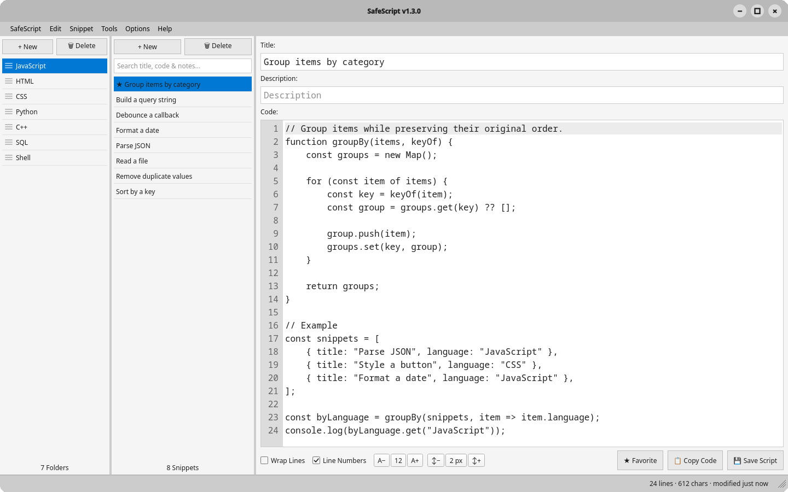
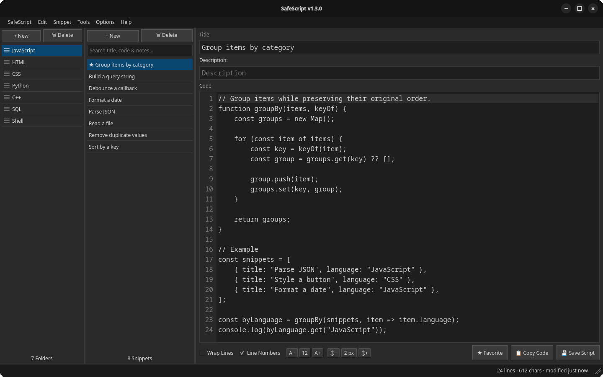
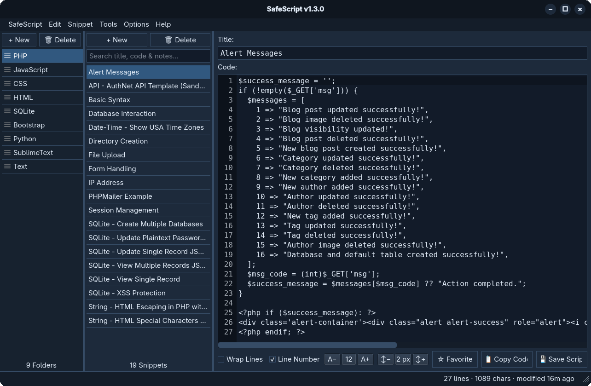
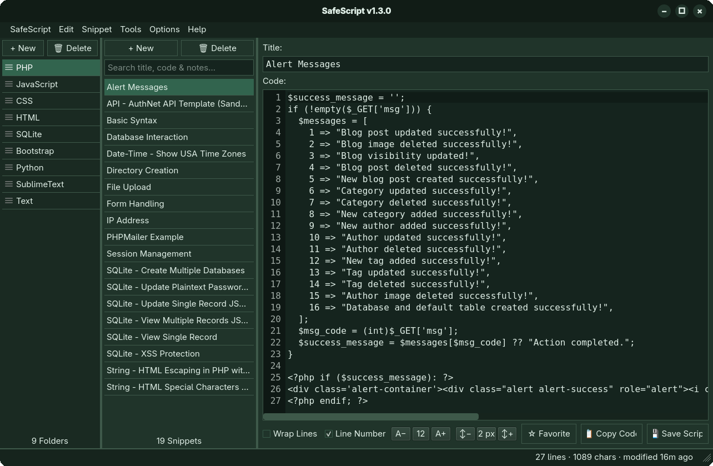
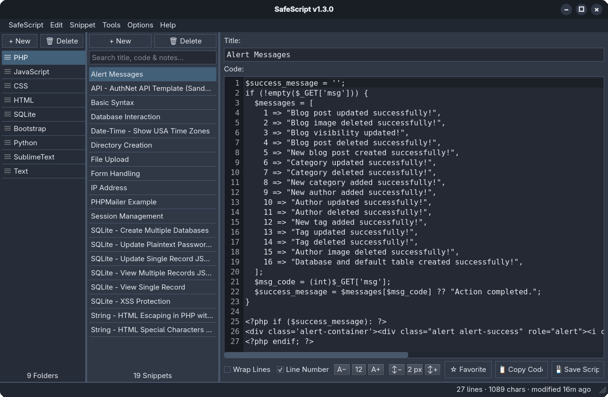

# SafeScript

A clean, fast code snippet manager for Linux built with Qt6.




## Color scheme screenshots







## What's new in 1.3.0

- **Snippet menu** for creating, saving, cloning, importing, exporting, and favoriting snippets. Import text and source files from the file picker or drop them into the selected category.
- **Editing tools** for sorting lines naturally, converting case, and editing multiple occurrences or lines at once. Find & Replace now opens above the code editor.
- **Code cleanup** for normalizing existing indentation, expanding tabs, removing hidden characters, and converting non-ASCII text. Each tool reports its result and leaves the edits unsaved for review.
- **Appearance controls** with nine color schemes, built-in Light and Dark Mode, monospaced font choices, and adjustable font size and code line height. Description and Notes can be shown or hidden independently.
- **Refreshed interface** with themed window controls, rounded menus and dialogs, a Favorite button, and direct links to project resources in Help.

## Features

- Organize snippets into categories, reorder categories by dragging, and keep favorites at the top of each list.
- Search titles, code, and notes. Copy code with one click or export a snippet or entire category to files.
- Toggle line numbers, wrapping, and the display of Description and Notes. SafeScript remembers your layout, preferences, and last selection.
- Store snippets in a local SQLite database with backup and restore.

## Keyboard Shortcuts

| Shortcut | Action |
| --- | --- |
| `Ctrl+N` | New snippet in the selected folder |
| `Ctrl+S` | Save the current snippet |
| `Ctrl+Shift+C` | Copy the current snippet's code to the clipboard |
| `Ctrl+F` | Find / Replace within the current snippet |
| `Ctrl+D` | Select the next occurrence in the code editor |
| `Ctrl+Shift+L` | Add a cursor to each selected line |
| `F9` / `Ctrl+F9` | Sort lines / sort lines case-sensitively |
| `Ctrl+Shift+D` | Clone the current snippet |
| `Ctrl+=` / `Ctrl+-` / `Ctrl+0` | Increase / decrease / reset editor font size |
| `Ctrl+X` / `Ctrl+C` / `Ctrl+V` | Cut / Copy / Paste |
| `Ctrl+A` | Select all |
| `Ctrl+Q` | Quit |

## Working with Snippets

- **Favorites** — click **Favorite** in the editor footer or use the snippet’s right-click menu. Favorites are marked with a star and sorted to the top of the list.
- **Clone / Move** — right-click a snippet to clone it or move it to another folder.
- **Find & Replace** — press `Ctrl+F` inside a snippet to search and replace within its code.
- **Search** — the search box matches snippet titles, code, and notes, not just titles.
- **Import from a file** — use **Snippet → Import Snippet** or drop text and source files onto SafeScript to import them into the selected category.
- **Export** — use **Snippet → Export Snippet** to save the current snippet, or **Snippet → Export Folder** to write every snippet in a folder out to files.

## Installation

<a href='https://flathub.org/en/apps/com.brainscanmedia.SafeScript'></a>

### Flatpak (recommended)
```bash
flatpak install flathub com.brainscanmedia.SafeScript
```

### Build from source

Requires Qt6 with Widgets and SQL modules.
```bash
git clone https://github.com/BrainScanMedia/SafeScript.git
cd SafeScript
qmake6 SafeScript.pro
make
sudo make install
sudo cp safescript.png /usr/share/icons/hicolor/256x256/apps/safescript.png
sudo gtk-update-icon-cache -f /usr/share/icons/hicolor/
sudo update-desktop-database /usr/local/share/applications/
```

This installs the binary, desktop entry, icon, and metainfo system-wide so SafeScript appears in your app launcher with its icon. Log out and back in if the icon does not appear immediately.

To uninstall:
```bash
sudo rm /usr/local/bin/SafeScript
sudo rm /usr/local/share/applications/safescript.desktop
sudo rm /usr/local/share/icons/hicolor/scalable/apps/safescript.svg
sudo rm /usr/local/share/metainfo/com.brainscanmedia.SafeScript.metainfo.xml
sudo gtk-update-icon-cache -f /usr/share/icons/hicolor/
sudo update-desktop-database /usr/local/share/applications/
rm -rf ~/SafeScript
```
Then log out and back in to complete removal.

## Data Storage

Snippets are saved locally depending on how you installed SafeScript:

**Flatpak:**
`~/.var/app/com.brainscanmedia.SafeScript/data/BrainScanMedia/SafeScript/storage.sqlite3`

**Build from source:**
`~/.local/share/BrainScanMedia/SafeScript/storage.sqlite3`

### Backup and Import

Use **Options → Database → Backup Database** to save a copy of your snippets anywhere on disk, and **Options → Database → Import Database** to load one back in.

Importing replaces your current database entirely, so SafeScript will ask you to confirm first. The selected file is validated before anything is overwritten, and your existing data is restored automatically if the import fails.

This is also the recommended way to move your snippets between the Flatpak and source builds, since each uses its own storage location.

### Export

Use **Snippet → Export Snippet** to write the current snippet to a file, or **Snippet → Export Folder** to export every snippet in the selected folder to a directory. Unlike Backup, which produces a single database file, Export writes plain, human-readable files you can share or keep in version control.

## Preferences

Use the editor footer to toggle wrapping and line numbers or adjust font size and code line height. **Options** also offers appearance controls and independent visibility settings for Description and Notes. Your layout — window size, column widths, and the code/notes divider — is saved automatically when you exit. **Options → Reset Window Size** restores the default layout without touching your snippets.

## Developer
BrainScanMedia.com, Inc.
[https://www.brainscanmedia.com](https://www.brainscanmedia.com)

## License
MIT — © BrainScanMedia.com, Inc.
